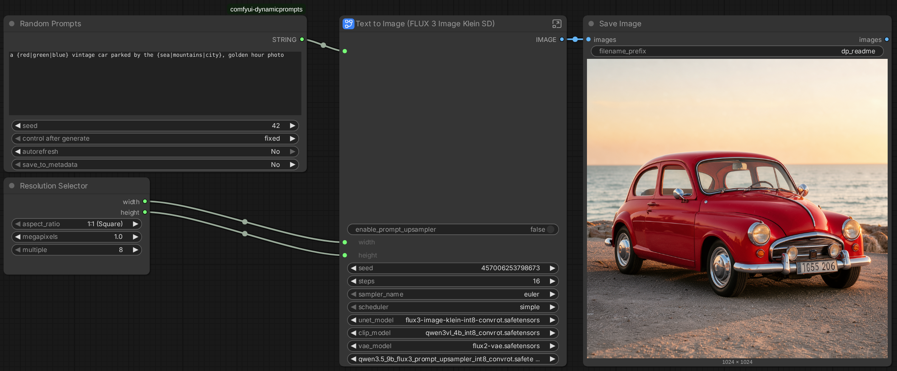
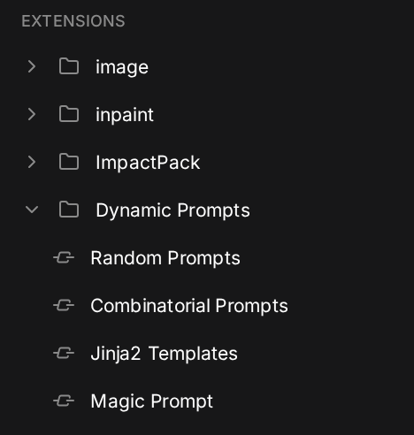

# Dynamic Prompts for ComfyUI



ComfyUI nodes for [Dynamic Prompts](https://github.com/adieyal/dynamicprompts): write one template such as `a {red|green|blue} car by the {sea|mountains}` and get a different prompt on each run, or step through every combination. Wildcard files, Jinja2 templates and Magic Prompt are supported too.

## Nodes

All nodes are in the **Dynamic Prompts** category.

| Node | What it does |
|---|---|
| Random Prompts | Picks one random variant for each `{...}` and wildcard in the template. |
| Combinatorial Prompts | Steps through every combination of the template, one per run. |
| Jinja2 Templates | Renders a [Jinja2 template](https://github.com/adieyal/dynamicprompts#jinja2-templates); templates can call `wildcard("...")` and include other templates from the wildcard folders. |
| Magic Prompt | Expands the prompt with a small language model that adds style and detail modifiers. |

The template syntax (variants, wildcards, weights, variables and more) is described in the [Dynamic Prompts syntax guide](https://github.com/adieyal/dynamicprompts/blob/main/docs/SYNTAX.md).

OutputString, from earlier versions, is deprecated: it still loads in old workflows but is hidden from search. Use ComfyUI's **Preview Any** node to see a generated prompt.

## Installation

**ComfyUI-Manager:** open the Manager, choose **Custom Nodes Manager**, search for `dynamicprompts` and install **Dynamic Prompts**. Restart ComfyUI.

**comfy-cli:**

```
comfy node install comfyui-dynamicprompts
```

**Manually**, from the ComfyUI folder:

```
git clone https://github.com/adieyal/comfyui-dynamicprompts custom_nodes/comfyui-dynamicprompts
python -m pip install -r custom_nodes/comfyui-dynamicprompts/requirements.txt
```

Then restart ComfyUI.

## Using the nodes

Double-click the canvas and search for `dynamic`, or open the Node Library and look under **Dynamic Prompts**.



Each node outputs a STRING. To use it as a prompt, drag the STRING output onto the text box of **CLIP Text Encode** (or any node with a text input); the text box turns into an input. Add a second node for the negative prompt if you want that randomised too.

### Seeds and refreshing

- **Random Prompts**: the same template, seed and wildcard files always give the same prompt. Set the seed's *control after generate* to `randomize` for a new prompt each run, or set `autorefresh` to Yes to ignore the seed.
- **Combinatorial Prompts**: the seed picks which combination to output, and wraps around. The `combinations` output gives the total, so with the seed set to `increment` you walk through them all: `a {red|green|blue} ball` gives a red ball, a green ball, a blue ball, then a red ball again. At most 10,000 combinations are generated. `autorefresh` set to Yes picks a random combination each run.
- **Magic Prompt** works like Random Prompts.
- **Jinja2 Templates** has no seed. The result is reused until the template or a wildcard file changes; set `autorefresh` to Yes to render it again on every run.

### Saving the prompt in the image

ComfyUI's image metadata stores the template (`a {red|blue} ball`), not the prompt that was generated. Set `save_to_metadata` to Yes on a node to also store the generated prompt: images saved with Save Image get a `dynamicprompts` entry such as `{"5": "a blue ball"}`, keyed by node id. With this on, the node runs on every queue instead of being cached, because a cached node can't write metadata.

## Wildcards

Put wildcard files in `ComfyUI/wildcards` or in the extension's own `wildcards` folder. More folders can be added under a `wildcards` key in ComfyUI's `extra_model_paths.yaml`. Files can be `.txt`, `.json` or `.yaml` (see [file formats](https://github.com/adieyal/dynamicprompts/blob/main/docs/SYNTAX.md#file-formats)), and a file at `wildcards/animals/cats.txt` is used as `__animals/cats__`. Edits are picked up on the next run without restarting ComfyUI.

Ready-made collections to start with:

- [Dynamic Prompts collections](https://github.com/adieyal/sd-dynamic-prompts/tree/main/collections)
- [More wildcard packs](https://github.com/adieyal/sd-dynamic-prompts/blob/main/docs/resources.md#wildcard-packs)

## Magic Prompt

Magic Prompt uses the [MagicPrompt-Stable-Diffusion](https://huggingface.co/Gustavosta/MagicPrompt-Stable-Diffusion) model, which is downloaded (about 500 MB) the first time the node runs and kept in the Hugging Face cache (`~/.cache/huggingface`, or `HF_HOME`). It needs the `transformers` package, which ComfyUI already installs; the extension doesn't install or change it. If the download fails, the error is shown in ComfyUI and the next run tries again.

## Example workflows

The `example_workflows` folder has a workflow for each node. Drag one onto the ComfyUI canvas to load it. They use the Stable Diffusion 1.5 checkpoint `v1-5-pruned-emaonly`; pick any checkpoint you have in Load Checkpoint.

## Links

- [Dynamic Prompts library](https://github.com/adieyal/dynamicprompts)
- [Syntax guide](https://github.com/adieyal/dynamicprompts/blob/main/docs/SYNTAX.md)
- [Dynamic Prompts for Automatic1111](https://github.com/adieyal/sd-dynamic-prompts)
- [Tutorial](https://github.com/adieyal/sd-dynamic-prompts/blob/main/docs/tutorial.md)
- [Online resources](https://github.com/adieyal/sd-dynamic-prompts/blob/main/docs/resources.md)
- [Stable Diffusion SDXL Wildcards and ComfyUI](https://ericri.medium.com/stable-diffusion-sdxl-wildcards-and-comfyui-e8483e00e1c)
- [Changelog](./docs/CHANGELOG.md)
